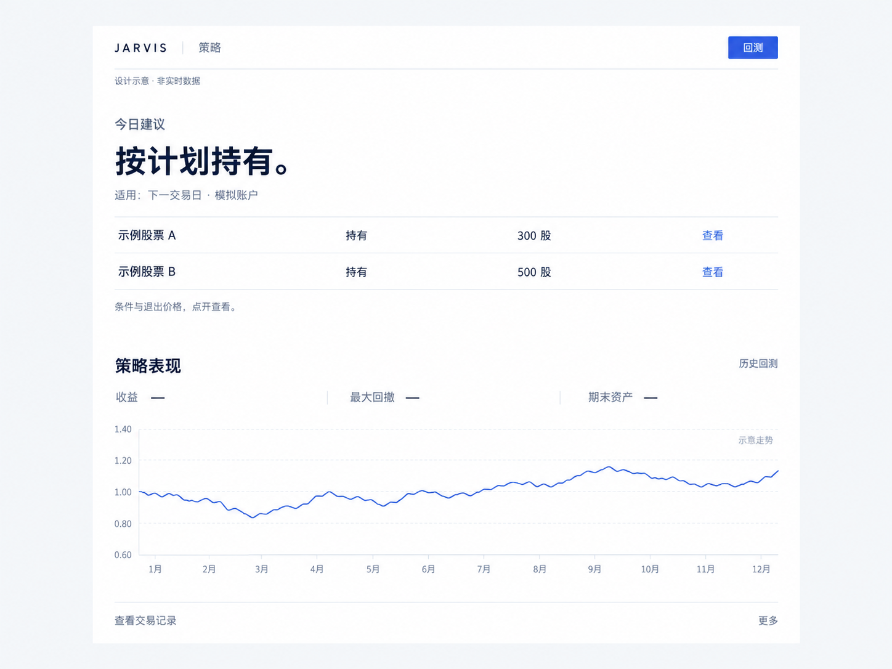

# 策略方案：每日计划、可信回测、逐步改善

> 更新：2026-09-16。本篇统一管理方案、页面设计和第十章待办；优先把现有能力做对、做简单。
> 当前状态：回测、队列和结果页已有实现，参数已补默认值；权益记账及展示仍需修正，日常自动发布尚未闭合。
> 当前完成度按逐项验收判断；本轮精简策略入口，既有回测结果保留，不代表收益已验证达标。

## 一、目标不变，近期交付缩小

默认50万元，最多两只，允许空仓；股票池为上一个完整自然月全A股累计成交额前20名，每月更新，不递补第21名。
现金账户只做多、不融资、不追加本金。年度目标为费用后账户收益>30%，进取目标≥100%，对应期末超过65万元、达到100万元。
每天提前给出下一交易日的条件计划，页面只读已保存结果。先用模拟账户；未接入实际持仓时，不能把模拟建议当作实盘账户订单。
近期只交付两件事：一张看得懂的每日计划、一份可以核对和比较的回测。先修正确性，再改善收益，不新增策略平台或复杂评分。

## 二、名词用简单解释

| 名词 | 含义 |
|---|---|
| 因子 | 从数据算出的指标；有的用于选股，有的只用于控制风险 |
| 均线、MA20/60 | 最近20/60个交易日的平均收盘价 |
| ATR | 衡量价格日常波动的指标；本方案取20日真实波幅的算术平均 |
| 相对强度、RS20 | 个股20日收益减同期沪深300收益，不等于已经剔除市场风险 |
| 市场宽度 | 全市场有效股票中，收盘高于20日均线的比例 |
| 回撤 | 净资产从此前最高值下降的比例 |
| 胜率、平均盈亏比 | 完整交易中盈利的比例、平均盈利金额除以平均亏损金额的绝对值 |
| 样本外检验 | 用未参与选规则、选参数的数据评价结果；反复查看同一年不算新的验证 |

## 三、当前效果差，先查这些原因

| 已看到的事实 | 对使用与研究的影响 | 本轮处理方向 |
|---|---|---|
| 页面先填复杂表单，再逐屏显示长文和明细 | 不知道每天该看什么，核心结果藏得太深 | 改为第九章单页，建议在上、表现在下 |
| 九组参数和压力数值写在Vue模板中 | 换本金或区间后仍看到同一张表 | 只展示关联到实际任务的结果，没有就显示未运行 |
| 风险推演直接按倍数放大收益和回撤，诊断固定称“交易品质极高” | 把算术和小样本包装成策略效果 | 删除推演及固定评价，风险变化必须实际重跑 |
| 部分参数覆盖问题已补默认值和校验 | 旧零成交记录不能代表当前规则 | 按实际参数与版本重新比较 |
| S0已改为直接计算ATR，但缺失时仍有8%回退 | 基准的缺数处理仍需核验 | 只留作研究对照，不作为可选策略 |
| 权益在除权日直接加入现金与股份；只有进度，没有完整账户断点 | 可用资金时点与连续运行尚不可信 | 对账修正；把每日发布与恢复列回待办 |

9月16日读取最新年度记录：S1/S2/F1收益2.73%/2.20%/4.14%，胜率77.8%/85.7%/50%，完整交易9/7/18次；S0收益0.63%，仅4次。小样本不足以证明稳定。

## 四、先保留一条策略主线

候选收敛为S1/S2/F1，S1仅为默认研究入口；S0撤出候选，只留作基准。移除未完整实现、无有效回测的S3，新请求直接拒绝。
保留全部历史记录与基准计算。胜率低不单独构成淘汰理由；同时比较费用后收益、平均盈亏、回撤及样本数，当前没有实盘通过版本。

| 版本 | 用途 |
|---|---|
| S0 成交额基准 | 仅研究对照，撤下可选入口和交易建议 |
| S1 趋势突破 | 周末或月末盘后评估新买，每天评估退出 |
| S2 趋势加择时 | S1增加指数趋势与全市场宽度控制 |
| F1 每日评估 | 仅将S2的新买评估改为每天盘后；不代表盘中实时交易 |

默认规则保持：收盘>MA20>MA60、MA20比五日前高、RS20>0，突破此前20日最高收盘，成交额为此前20日均值1.2～2.5倍。
新买收盘不超过MA20+3ATR；按RS20降序，月成交额名次、代码升序处理同分。此前窗口不含信号日，缺数据不当作0。
初始退出线为信号收盘−2.5ATR；跟踪线只升不降，取原线与入场后最高收盘−2.5倍入场ATR的较高值。
跌破退出线、连续两日低于MA20、离开月池或触发风控，下一允许时点退出；完全退出后冷却5交易日，不主动加仓。
S2/F1依次判断：宽度<35%则仓位上限0%；指数收盘>MA60、MA20上升，宽度≥55%且不低于五日前则80%；
否则宽度≥40%且五日增加≥5个百分点则30%，其余20%。提升须连续两日，下调当晚生成计划，不保证次日一定成交。
回踩、行业、情绪、资金流、财务增强暂缓；只有基础结果可信且归因明确，才登记一个增强假设。当前概念关系不能回填历史。

## 五、资金与交易规则保持严谨

默认股票市值上限为净资产80%、单股40%；单股计划损失1%、合计2%。支持自定义本金和总额度，风险设置收进高级选项。
同一行业或60日收益相关系数>0.8的两股合计上限50%；未知按同组。回撤10%减半市场上限、15%禁新增且上限20%、20%停用。
较低级别恢复须连续5日回撤<8%且市场非退潮；20%停用后本次回测不重启。这些为研究默认值，不能保证实际损失止于阈值。
股数同时受现金、额度、退出距离、风险预算及交易单位限制；不能用80%上限代替实际仓位，更不能为追目标自动增加风险。
当晚固定买入区间、数量、退出线、有效日期和取消条件；按最不利允许买价计预算。次日超价或不满足条件就取消，不重新排序。
采用原始价格成交、当时可用的复权数据算指标；T+1、停牌、涨跌停、申报数量和费用均按交易当时规则处理。
默认双边佣金万三、最低5元，单边滑点10基点；法定税费按日期另计。权益分清应收、到账和可售，税款及卖出后的应收归原交易。

## 六、后台只保留一条日常流程

`收盘数据更新 → 检查必需数据 → 延续账户并计算 → 保存次日计划 → 页面读取`。
22:00截止，23:00前发布下一交易日计划；没有信号也保存“继续持有”或“空仓观察”，失败单列，不能把失败显示为无信号。
复用Go、SQLite和现有队列，仅quant-backend访问量化库。市场指标按日共用；回测和日批使用同一计算逻辑，不再写另一套。
优先保证日批，研究任务串行排队；日批完成且有资源时才运行研究，不要求机器一直满负荷。查询、切页和刷新都不触发计算。
保存有效参数、实际输入、代码与规则版本；同一请求重试不得重复记账。完整交易日保存现金、股份、应收税款、订单、退出线和回撤状态。
发生中断要明确是从头重放还是从断点继续，未经验证不得称为断点恢复；历史研究不得借分段重置账户或回撤。
先测输入准备、逐日计算、保存、查询各自耗时及内存，再优化最慢环节；不为优化加新服务、增加数据库连接或重复全量计算。

## 七、先得到可信对照，再验证收益

先通过同一正式后台入口运行S0/S1/S2/F1，默认区间2025-09-05至2026-09-04，本金、风险、费用和数据一致。
页面提交与直接调用必须得到相同有效参数和流水；校验分红前后现金、股份与净资产，抽查买入、退出和未成交原因。
每份报告只回答：赚了多少、最多回撤多少、平均投入多少、完成多少笔交易，以及相对基准是否改善。
明细分别统计评估次数、符合条件、计划下单、实际成交及拒单原因；不同分母的独立计数不能画成逐级下降的筛选图。
胜率旁同时显示盈利/完整交易数，样本不足明确说明；平均盈亏比与“总盈利/总亏损”分开，不把买入笔数当突破次数。
再用费用加倍、买入延迟一日复验；加倍仅指佣金和滑点，延迟仍遵守原数量、区间和有效性，不利用未来价格。
每次用此前30个月开发、后半年检验；开发后18个月与外部检验均延续账户。至少四个半年、50个完整周期为研究门槛，不代表统计保证。
已看过的指定年度只作历史展示；重叠年度达标次数不是未来达标概率。收益必须按期末账户净资产计算，含现金和全部成本。

## 八、持续改善采取小步验证

先解释亏损或收益不足，随后每轮只改一个假设：信号少检查过严筛选；投入少检查风险与退出距离；亏损集中检查退出和共同下跌。
增加回踩买点属于新的策略假设，同时改变退出线时须明确记录；不能用增加交易次数代替效果改善。
已有规则通过基准和费用验证后，才开放一次九组搜索：突破周期15/20/25日×跟踪ATR倍数2/2.5/3，其余固定。
只在开发数据选参数，比较后续表现及相邻参数；相近优先保留原版。每组都保存真实任务、有效参数、失败原因和结果。
没有新增有效证据就停止计算并等待；常规重新选参至少间隔半年且新增100个交易日，不反复拟合同一历史年度直到达标。
旧方案167块完整研究暂缓；先完成四版本对照和真实日计划。扩大研究范围须先解释新增检验要解决什么问题，不自动扩展参数。
通过后先连续20交易日模拟推荐检查运行与执行，再持续记录一年；策略变更保留旧版本，旧仓沿用原退出规则。

## 九、页面

一页两段：上方是今日建议，下方是策略表现。沿用`/lab-strategy`，右上角只有一个“回测”按钮。
下面是视觉稿，仅表达布局；股票和走势为示意，不是实际运行结果。

1. **今日建议**：一句结论，最多两只股票，每只一行；显示操作、价格与数量，点“查看”打开退出线和条件。无机会就留白说明。
2. **策略表现**：收益、最大回撤、期末资产，下面一张净资产曲线。交易记录、对照、调优和导出放“更多”，不铺满首屏。
3. **回测**：点击才打开侧栏，填写时间、本金、股票额度；高级参数收起。计算状态留在侧栏，不打断查看原报告。
4. **视觉**：浅灰底、白色内容区、深蓝字，蓝色用于操作和曲线；不用成排卡片。内容宽960px，区块间距40px，标题28px、正文15px，手机单列。
5. **数据**：始终标明适用日、数据日期、模拟或历史身份；缺数、失败、过期各自说明。曲线标明日期与金额，盈亏带正负号，所有成绩取自所选任务。

配色：背景`#F5F7FA`、内容`#FFFFFF`、正文`#172B46`、辅助`#617086`、操作`#2457D6`、分隔`#E1E7EF`。
沿用系统中文和现有字体，数字等宽对齐；仅调整策略页，不新增图表库或动效。此设计尚未实施。

## 十、编号待办与完成标准

保留原序号；已实现部分继续复用。“有代码”“算完了”“通过验证”分开记录，T10旧记录保留，不代表以下各项均已完成。

| 序号 | 当前状态 | 本轮工作与完成标准 |
|---|---|---|
| 1 | 已完成 | 简化本篇，明确单页布局、真实结果要求和下面的优先顺序 |
| 2 | 部分完成 | 核查参数默认值及校验、S0指标、市场指标日更和必要数据；相同有效配置经页面/API得到相同输入 |
| 3 | 需修正 | 权益按应收、到账、可售及税款对账；公平S0不回退8%，相关记录能逐日核对 |
| 4 | 待复验 | 通过正式队列重跑四版本年度报告；保留参数、输入和流水，给出未达标的实际原因 |
| 5 | 部分完成 | 补齐模拟账户延续、每日定时发布及完整恢复；连续5交易日准时发布，重启不重复记账 |
| 6 | 部分完成 | 复用队列完善日批优先、去重、有限重试和耗时记录；日批不被研究长期占用 |
| 7 | 待复验 | 四版本通过后才做九组、费用及后续时段检验；每格有真实任务，没有稳定改善就保留原版 |
| 8 | 需简化 | 依第九章实现单页；先去掉固定成绩和算术推演，再按视觉稿调整排版，核对手机、空态、过期与导出 |
| 9 | 待开展 | 合格版本开展20交易日模拟推荐及后续观察，达到复审条件才重新选参 |
| 10 | 已完成 | 停用S3新任务，撤下S0候选入口，保留历史与基准；构建、HTTP、页面选项及32条历史读取核验通过 |

执行顺序：先2、3与8的错误展示修正，再4；随后5、6与8的页面整理，最后7、9。没有可信结果时先展示明确状态。
实施提示词：按本方案第十章第N项，只修必要问题；复用已有能力，接口先改契约，不新增单元测试。提交真实回放或界面验证证据，再更新状态。

## 十一、依据与历史记录

[本次代码与使用复审](acceptance/usability-review-20260914.md)列出问题位置及T10状态修正理由；[T10原记录](acceptance/T10-annual-campaign-20260914.md)保留原结论供追溯。
[策略精简记录](acceptance/strategy-pruning-20260916.md)记录本轮HTTP结果与移除范围；最新结果不与旧错误输入混为同一版本证据。
[验收索引](acceptance/README.md)保存原始证据；[历史资料](history.md)保留详细研究规则。当前范围、页面与执行顺序以本篇为准。
