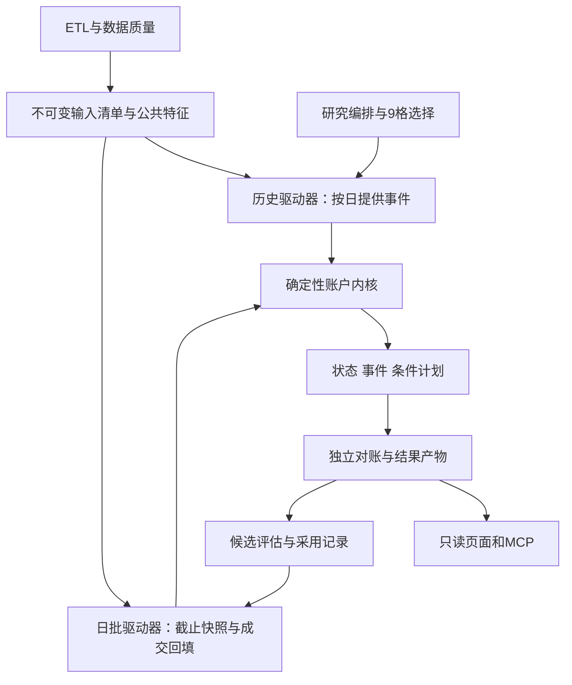

# Jarvis量化研究架构与技术决策

> 历史参考：当前方案与待办已合并至[策略研究与实施方案](plan.md)。下文保留原日期记录；“方案被替代”不代表功能已验收。

研究目标是把50万元、最多两只持仓的策略变成可核对、可持续评估的账户政策。现阶段适合保留Go量化后端与SQLite的单属主边界，补齐确定性重演、输入版本和研究编排。
本文是待实施技术设计；当前数据观察、年度阻断和代码证据见[审查附件](acceptance/campaign-review-20260913.md)。
总体目标及统计协议分别由[持续研究主线](continuous_research.md)、[年度实验](annual_campaign.md)定义。

## 1. 架构判断与隐藏缺口

| 审查发现 | 影响 | 技术处置 |
|---|---|---|
| S0默认固定8%退出，S1采用2.5ATR | 资金使用与退出风险不同，收益差不能全部归因选股 | 先实现同口径S0风险基准，旧版保留历史身份 |
| actionGuard记“曾买入”而非当前权益义务 | 已卖出证券可能长期阻断；直接删保护又会漏应收权益 | 显式权益/税费状态替代永久bought布尔值 |
| TradeCycles只读买卖fills | 卖出后到账分红、送股、税费不能归入原周期 | 以cycle_id连接成交、权益和税费事件 |
| S12的LimitDay未装配时返回false | 缺限价信息会与“不是涨跌停”混淆 | 资格/限价输入显式完整性，未知不能默认为可成交 |
| checkpoint仅更新progress并检查取消 | 重启回到原输入从头重放，不能跨年连续接续 | 保存完整日终State及事件游标 |
| 单worker领取时才检查ETL | 长研究正在执行时，新ETL不能优先；大量回补还可能占住日批 | 各任务类别支持安全块和依赖优先级 |
| DB单连接加互斥，coverage含全表聚合 | 查询、取消状态及日批也会等锁；多开计算协程未必提速 | 离线摘要、短事务、分块读后释放锁 |
| 完整input_json每run保存，代码版本靠手工常量 | 网格复制价格、资源重复；漏改常量可能误认同版本 | 共用内容对象与真实构建摘要 |
| 当前任务API无策略参数，回放日期限366天 | 无法直接实现9格和多段账户政策 | 白名单参数契约及内部状态接续先行 |

这些发现来自现有任务、数据库和策略实现，不是对已完成子项的整体否定。短区间成交流水与基础周期仍可复用。[^1]

## 2. 一套账户内核与两个驱动器

核心语义为`前一State + 当期已知输入/执行事件 + 冻结配置 → 下一State + 事件 + 条件计划`。
策略核心不查询DB、网络或当前时钟，不直接发布结果；排序、随机种子、费用舍入和缺失处理显式传入。
历史驱动器把真实后续行情仅交给执行模拟器；日批驱动器以实际成交回填或明确标记的模型成交推进账户。
核心内部将“执行/记账”和“盘后决策”分阶段，防止未来开盘、盘中最高价被候选排序读取。
先让现有S0/S12调用同一账本和规则适配层，保持策略信号差异；不要求一次重写全部runner。
具体状态及公司行动顺序见[replay_protocol](replay_protocol.md)。

## 3. 代码落点与技术选择

| 位置 | 职责与首版技术 |
|---|---|
| internal/strategy | 纯计算State、事件应用、因子、规则策略；Go结构体和确定性排序 |
| internal/engine | 准备版本化输入，装配日历/资格/事件/市场特征；不根据收益修改数据政策 |
| internal/api | 验证提交、只读查询、暂停取消；现有worker调用编排器，不在HTTP内重演 |
| internal/db | 事务、迁移、内容对象和状态持久化，继续唯一DB实例 |
| internal/sched | 沿用现有cron，只产生有幂等键的任务 |
| frontend / mcp-server | 消费冻结产物；不引入另一份信号、资金分配或胜率计算 |

首版采用有限状态机和明确依赖的任务清单，不增加通用工作流引擎、消息集群或策略微服务。
JSON、SHA-256和标准库足以保存首版输入与状态；缓存压缩、列式格式、外部对象存储须由测量结果触发。
SQLite WAL允许读写并发，但本项目当前单连接/互斥封装依旧串行；WAL不能自动解决全表统计阻塞。[^2]
先改善读取范围和锁持有时间；若后续仍不满足预算，再另立同一属主进程内部连接设计，不绕过AGENTS。

## 4. 最小持久化方案

下列为逻辑设计，真实表名/列类型须先进入契约和database规范；不声称已经建表。

| 对象 | 最小字段/约束 |
|---|---|
| strategy_campaigns（新增） | campaign_id、状态、当前cycle、next_wake、冻结政策引用、累计计算/试验预算 |
| strategy_artifacts（新增） | hash主键、kind、schema_version、内容、创建时间；同hash异内容拒绝，内容不可更新 |
| strategy_runs（扩展） | campaign/cycle/phase、input_ref、parent_state_ref、checkpoint_ref、attempt、结果引用 |
| strategy_accounts（日批新增） | account_id、配置版本、当前state_ref、更新时间及乐观版本号；研究账户仍归各run |
| strategy_publications（日批新增） | 账户/决策日/批次版本、结果引用、状态、截止/完成/发布时间；保留旧版本 |

每cycle的完整计划和评审保存为不可变artifact，不先复制一套通用DAG表；每个run记录对应计划项ID。
价格/日历/市场/规则按月或用途形成共享内容对象；run只引用对象、账户和参数，不复制9份同源行情。
大型对象按区间分块并设置行数/大小上限；特征缓存不是另一份可随时改写的交易真源。
关键索引：run状态/可运行时间、campaign/cycle/计划项、publication账户/决策日/版本；SQL以EXPLAIN验收。
同一日完成时事务保存事件清单、State引用和进度；暂停恢复依此游标，不靠“已算到48%”推算状态。
State仅保留当前状态、未了义务和累计统计；成交/权益事件按日增量保存，避免每个断点复制全部历史fills。
发布事务同时核对预期账户状态版本、保存结果引用并切换当前指针；账户回填变化时拒绝发布过期计划。
已引用输入、已发布结果与账本不可因缓存清理删除；仅清理无引用临时产物，期限沿用retention规范。

## 5. 版本与历史可用性

每个输入清单保存数据业务日期、来源、采集时间、业务可用时间、修订版本和缺失策略；未留存历史者标明代理。
已有现值表无法凭一个hash还原旧版本；首次冻结须保存实际所用记录，从此以后保留被引用版本。
概念/财报的有效时点与采集时点分开；禁止把今天下载的关系填写成过去早已可得。THS成分为最新口径。[^3]
多次分块读取需绑定同一已发布数据版本；若旧表还不能按版本读，冻结期间串行阻止相关发布，先保存输入再释放。
不能在ETL继续覆盖现值时仅记录一个起始时间，并将跨版本读取包装成一致快照。SQLite快照隔离以事务为边界。[^2]
模型摘要包含策略及输入装配源码、go.mod/go.sum、编译器和执行/费用规则版本；Git提交号无法覆盖本仓未跟踪源码。
同版本重放一致与“增加未来数据不改共同前缀”分别验收；人工model_version字符串只是说明，不能独自证明一致。

## 6. 计算方案与可测预算

全A宽度和月金额使用分块聚合/滚动状态，一份输入一次计算；证券侧只准备当前池、旧仓及待处理权益所需数据。
热路径使用按日期对齐的类型化数组与缺失位，避免每股每日重建map和窗口副本；缺日不能压缩成连续N条。
MA/量能用滚动和，HC/H用固定窗口或单调队列，ATR沿用现有TR算术均值；禁止优化时偷偷改成Wilder平滑。
复权工作尺度及增量失效规则见replay_protocol；历史修订应重建受影响窗口，不能只比较最新日期是否改变。
单研究消费者、一个价格对象加逐组账户状态起步；九格依次重演，避免九份全量现金/价格轨迹常驻内存。
指标记录queue_wait、snapshot_load、feature、replay、audit、persist耗时，以及RSS、锁等待、缓存命中和事件数。
coverage现有一次43.37秒观测说明查询链值得优先处理；尚无年度重演性能基线，不先承诺每秒多少次回测。
目标沿用quant<400MB、只读P95<500ms；研究安全检查点目标≤30秒，按代表性快照实测后冻结块大小。
≤12月的预算块与≤30秒的调度片段是不同单位；细分让出不增加策略试验，也不能借细分清零167/200预算。
资源块、唯一假设/参数数和结果访问次数分别统计；不能直接把167当成DSR中的独立策略试验数。

## 7. 分阶段交付与不做的提前建设

| 顺序 | 首份具体产物 | 验收重点 |
|---|---|---|
| A：重演正确 | 权益State、同口径S0、年度S0/S1账本 | 原始成交、权益守恒、缺行解释、两只限制和费用 |
| B：市场与日批 | S2/F1市场输入、固定数量计划、账户版本及只读发布 | 历史/日批共核、22:00截止、晚到/失败语义 |
| C：持久化研究 | 参数契约、campaign、完整断点、预算与9格 | 取消/重启/依赖变化/缓存、无增益报告 |
| D：政策验证 | 四折、年度重起、压力与候选观察 | 无未来信息、不拼最佳曲线、接管保留风险状态 |

机器学习排序留到基线有稳定增量、标签及样本外流程通过以后。届时先比较少量正则化线性因子，而非直接增加模型复杂度。
训练标签继续与5/10/20日价格诊断、可执行账户结果分开；小Top20、重复日期和重叠持仓不能算成大量独立样本。
输出胜率概率还须校准及独立验证；现有排序分数不显示成百分比成功率。反复搜索同一历史不会创造新信息。[^4]

## 来源

[^1]: Jarvis当前源码，[研究worker](../../services/quant-backend/internal/api/strategy_worker.go)、[任务调度](../../services/quant-backend/internal/api/etl.go)、[数据库封装](../../services/quant-backend/internal/db/db.go)，2026-09-13代码审查及附件摘要。
[^2]: SQLite官方，[Write-Ahead Logging](https://www.sqlite.org/wal.html)、[Isolation In SQLite](https://www.sqlite.org/isolation.html)，2026-09-13查阅；用于事务、并发和快照语义。
[^3]: Tushare官方，[概念板块成分](https://tushare.pro/document/2?doc_id=261)，2026-09-13查阅；最新成分口径。
[^4]: Bailey等，[The Probability of Backtest Overfitting](https://www.davidhbailey.com/dhbpapers/backtest-prob.pdf)，2015；重复试验与选择偏差。
