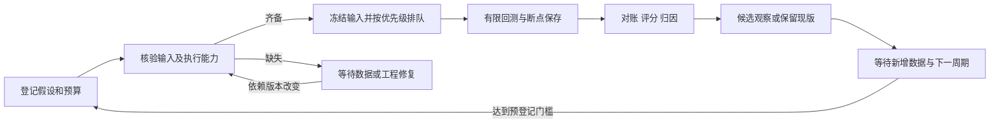

# research_daemon — 后台常驻研究、有限调优与发布

> 历史参考：当前方案与待办已合并至[策略研究与实施方案](plan.md)。下文保留原日期记录；“方案被替代”不代表功能已验收。

> 2026-09-13；待实施的编排规范。现有后台单次回测可以复用，campaign与自动调优尚未部署。
> 归属quant-backend；不新增进程直连量化库，不让浏览器、MCP或LLM计算账户组合。

最小存储、模块落点及确定性内核见[quant_architecture](quant_architecture.md)，完整账户断点见[replay_protocol](replay_protocol.md)。

## 1. 长期运行的含义

一个长期研究项目campaign持续接收数据变化、执行已登记实验、生成报告并积累未来观察。
子批次完成后可等待新数据，持续服务不等于无休止重复搜索同一历史。
每天按已采用的参数计算次日计划；候选研究在后台进行，两者由独立版本和账户状态绑定。
规则模型的“训练”主要是开发期比较与有限选参，首版不引入神经网络、强化学习或自动改代码。
即使没有达到30%/100%，也必须交付本批全部结果、目标缺口和下一步，而不是只有“继续运行”。

## 2. 状态与任务持久化

| 层次 | 保存内容/行为 |
|---|---|
| campaign | 目标/账户/窗口/家族/预算/选择政策、父项目、累计试验及终测访问记录 |
| cycle | 一次冻结数据上的完整实验清单、阶段、剩余预算、下次唤醒条件 |
| run | 复用PENDING/RUNNING/COMPLETED/BLOCKED/FAILED/CANCELLED及不可变输入/结果 |
| checkpoint | 已处理日期、现金/持股/成本批次、应收/税费、订单、冷却、最高净值、停用、策略归属 |
| artifact/review | 统计/图表/全量明细、有效性、两级目标、采用/保留/拒绝/证据不足及理由 |

campaign状态至少区分READY、RUNNING、WAITING_DATA、WAITING_ENGINE、WAITING_NEW_DATA、PAUSED、CLOSED。
“执行完成”“历史目标达成”“可以采用”分别保存，不把一次期末翻倍自动写成整个研究项目成功。
所有新字段/操作先定义shared/contracts，再做迁移及实现；本文不宣称已有campaign API或可直接提交的JSON。
后台报告可以由确定性规则自动生成；LLM只解释已冻结结果、提出待登记假设，不修改参数、预算或生效指针。

## 3. 触发频率和优先级

| 触发 | 自动做什么 | 不自动做什么 |
|---|---|---|
| 初次启用 | M00预检；通过后按annual_campaign分阶段放行 | 带着权益阻断反复提交年度回测 |
| 每个交易日数据就绪 | 更新公共特征；22:00冻结，23:00前发布结果或明确失败 | 看盘、刷新时重新选股/算股数 |
| 23:30～次日06:00可用时段 | 低优先级领取研究块、冻结候选继续影子观察 | 抢占必要ETL或为达标扩大参数空间 |
| 每周 | 数据/权益/执行审计，失配定位，报告任务耗时与缺件 | 最近亏一笔就换参数 |
| 每月 | 汇总机会/金额漏斗、市场状态、净R与两仓共同风险 | 按本月最佳参数接管账户 |
| 首轮完成后每半年，且新增≥100交易日 | 按冻结政策启动下一张9格表 | 不足新样本时重复寻优同一年度 |
| 数据修订/正确性修复 | 作废受影响绩效，产生新版本并重放依赖 | 用数据变化悄悄覆盖旧已发布建议 |

调度优先级：必要当前ETL → 到期日批/发布 → 当前数据修复 → 历史回补/研究；研究单并发起步。
夜间也有既有采集任务，研究窗口不是独占时段；定时器只入队，不能在调度或HTTP线程运行回测。
临近日批停止领取长研究块；在安全检查点让出执行权，支持暂停、取消及同版本恢复。
如果来源或工程依赖未改变，保留同一个阻断记录，只更新观察时间；不能形成失败重试忙循环。

## 4. 有限搜索与自动复审

执行前冻结完整清单：参数、账户、日期、场景、标签成熟、比较对象和预算，首轮详见[年度实验](annual_campaign.md)。
只允许一个家族9组离散组合；日期、目标收益、本金、风险、费用和选股范围不进入优化空间。
每个外层边界按已冻结政策使用过去开发数据选参；这属于一次登记的历史复演，不是额外的日常调参权限。
完成后依次判定：输入/账本无效 → 证据不足 → 风险是否合规 → 稳定验证增量 → 历史目标与缺口。
自动归因至少包含信号少、风险后股数不足、名额占用、追价拒绝、失败突破、市场退潮、成本及收益集中。
规则可根据这些结果生成下一步提案；未登记新假设不得由LLM自行增加因子、优化维度或尝试次数。
单批9格完成、无稳定区域、预算耗尽或缺新数据时停止搜索，进入观察；只有新的合格周期才再计算。
30%/100%达标后也保留全部失败格点并继续前瞻观察，不自动放大仓位或下单。

## 5. 计算效果和资源边界

全市场月度成交额、宽度、指数和公共特征每个输入版本只算一次；不能每个参数/账户重扫千万行。
池内证券加旧仓/待退出使用必要窗口；采用分块读取、短锁、Go内存计算、结果批量保存。
价格/特征可以共享；不同本金、风险和订单状态必须重演各自现金股数，不能缩放旧账本。
冻结输入引用可版本化分块存储，必须能还原；缓存key包含数据/参数/规则/执行/费用/日期/账户版本。
概念采集开始保存观察时间和版本，历史修订保留旧版本；有效时间与采集时间分别记录。
公共覆盖摘要改为ETL后离线生成，GET仅读摘要；本轮coverage请求43.37秒是观测值，不是性能目标。
quant整体遵守现行400MB资源红线；不同时常驻全市场十年行情、每个网格副本和多个账户全量快照。
先测阶段耗时、RSS和DB锁等待，再定块大小；安全检查点目标≤30秒响应取消/日批让出，待实际验证。

首轮最多200计算块，计划167；当前活动队列最多20，编排器按容量释放子任务，不能靠提高并发提速。
缓存命中不增加新独立样本；改数据后的重放计入计算预算，搜索谱系不因拆批、改名或重启清零。
依赖无变化的BLOCKED不重试；临时执行失败最多3次，按1/5/15分钟退避，之后暂停该项并报告。
预算耗尽进入PAUSED或WAITING_NEW_DATA，写出已完成、未运行、失败及目标差距，不宣称参数已收敛。
固定候选的每日增量观察另记运行预算；它不产生新参数试验，也不能借监控名义穷举新组合。

## 6. 日批采用和回退

初版自动完成研究和生成候选，生产采用仍形成明确记录；候选不会因为昨天赢了就自动替换现版。
以后若开放自动采用，须先验证整个滚动选择政策，再登记生效规则，不只验证单个网格赢家。
换版只作用于未来新意图；旧仓、应收、现金、两只名额、冷却及回撤停用状态接续，回退同样不能清零。
日批发布绑定账户状态与成交回填版本；没有真实回填时仅能发布明确标记的模型账户建议。
原子发布完整结果或失败状态；旧成功结果保留原日期，不能显示成今日已完成。
GET、刷新、导出和解释仅读产物；无今日结果也不触发计算。条件核对不产生新的盘中策略。

## 7. 看板与可验收产物

日常页：数据截止/发布状态、市场状态、最多两只计划、条件价格/失效点/金额、不买理由与账户来源。
研究页：50万基数、W0、65万/100万门槛线、期末与首次触及、风险内达成、未实现及受困资产。
任务页：阶段/剩余预算/下次唤醒、完成/失败/未运行/缓存、正在等待的数据或工程项；不显示无限旋转。
诊断页：机会与金额双漏斗、0/1/2仓天数、权益/费用、两仓同跌、盈利集中和年度目标缺口。
调优页：全部9格、G/最差块/样本数/回撤、稳定邻居、父子差异、访问过的测试及不更新理由。
年度页：不同年度起点重新50万回放与连续净值切片分栏，开发/历史复演/冻结后观察分别标色和标注。

验收须覆盖：无新数据不重复搜索、相同输入恢复一致、取消/重启不重账、预算不超、失败记录不丢。
还须验证研究让出日批、跨折/换参账本接续、旧仓不产生第三只、读取不创建作业、未达目标正常出报告。
本阶段按用户要求不做单元测试；实施时采用必要build/vet、真实HTTP/冻结样本回放、账本对账与性能记录。
