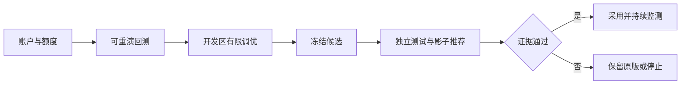

# visualization — 回测、对照与调优工作台规划

> 历史参考：当前方案与待办已合并至[策略研究与实施方案](plan.md)。下文保留原日期记录；“方案被替代”不代表功能已验收。

> v0.4；2026-09-07已有Vue3回测页面、净值/回撤SVG和表格，完整工作台尚未交付。
> 实施状态：部分实现，不可归档；配置绑定、账户情景和回放缺口见[status.md](status.md)。

## 1. 产品主路径

日常路径：`选择已生效账户 → 读取下一交易日已发布计划 → 查看条件、持仓与原因`。
研究路径：`配置账户与目标 → 后台回测/有限调优 → 读取结果 → 对照归因 → 冻结候选`。

建议单一“策略研究”入口，页内分配置、结果、调优、交易回放、版本记录，避免分散到多个无关联页面。
首屏优先日批结果、数据截止和有效交易日；详情见[daily_batch.md](daily_batch.md)，刷新和缺缓存不触发补算。
页面已注册/lab-strategy，不占/admin、/mcp、/doc代理前缀；下列完整流程仍为待验收设计。


样式与图表选型遵守 [frontend/style.md](../frontend/style.md)，运行时不显示无来源的示例绩效。

## 2. 配置面板

| 区域 | 交互 | 必须说明 |
|---|---|---|
| 账户与目标 | 输入本金、1/2只、目标倍数或期末金额 | 目标随本金变化还是固定金额，必须可见 |
| 总额度 | 切换净资产比例、固定金额、同时约束；另设保留现金 | 持仓额度、风险额度、累计交易额分开，不混名 |
| 风险与执行 | 单股/组合计划风险、回撤阈值、权限、费用情景 | 显示输入上限与最终实际约束，不能省略费用 |
| 研究范围 | 数据版本、起止日、开发/验证/测试区间 | 已被查看的测试数据标记已接触 |
| 参数模式 | 默认参数 / 手动单组 / 有限3×3空间 | 不提供“优化全部参数”或无边界自动搜索 |
| 提交前预览 | 配置差异、有效数据范围、初始额度、任务数量 | 超限、缺关键数据、目标已在期初达到各自解释 |

改输入只更新草稿；保存日常配置显示生效批次，显式提交研究才创建后台run，现有结果始终保留原配置。
拖动金额或参数滑块不触发后台回测；避免大量隐形尝试和旧结果被误认成新参数结果。
账户情景对照与策略寻优分别操作；比较不同风险额度时固定显示“情景不同”。

## 3. 结果首屏

```text
配置摘要：本金 / 总额度模式 / 目标 / 最多两只 / 数据与策略版本 / 开发或测试标签
完整账户期末净资产 · 成本后收益 · 最大回撤 · 实际平均仓位 · 有效周期/未成交数
────────────────────────────────────────────────────
净值与同约束基准                  年度目标窗口分布与有效样本数量
回撤（与净值同时间轴）            资金/信号逐层减少的原因
实际仓位、允许仓位、现金          绑定约束：市场/风险/金额/整手/名额
────────────────────────────────────────────────────
版本或参数比较表                  所选日期的两只持仓与待执行意图
```

默认完整账户净值，显示原始金额与起点为1的归一化净值切换，分母始终明确。
不默认只画已投入部分收益；成本、现金和不可变现持仓不可隐藏在“高级选项”。
零交易不是错误，也不是策略获胜；空数据、未运行、失败、全现金和未达标分别呈现。
日常结果须区分待发布、缺数阻断、发布延迟和过期；可查看旧版，但旧日期不得被显示为今日已生成。

## 4. 六组核心视图

| 视图 | 展示方式 | 支持的判断 |
|---|---|---|
| 净值/回撤/仓位 | 三图共用时间轴，标注开发/测试、换版和停用 | 收益何时获得，承担了什么风险，用了多少资金 |
| 目标窗口分布 | 12月重演的分布图＋逐起点表，显示目标线、命中数与重叠 | 是否只在个别起点达到目标 |
| 参数稳定性 | 3×3格点；可切换增长、回撤、成本、样本数 | 是否存在稳定区域，最优是否孤峰或边界 |
| 风险收益对照 | 收益-回撤散点，大小编码资金使用率；同账户可比较 | 增益来自选股还是提高风险/仓位 |
| 机会与资金漏斗 | 人数与金额两个视图，独立拒绝数与顺序剩余分开 | 机会在哪一步被拒，闲置资金原因是什么 |
| 单笔回放 | K线/量能、当时退出线、信号、意图、成交/拒绝、额度明细 | 是否存在未来信息、追高、错用股数或理想成交 |

净值切片的12月收益与重新起投12月结果分栏，不将两者混成同一分布。
参数图中的未运行格点留空，失败/数据缺失用独立图案或状态；不插值出“最优区域”。
热图默认展示验证数据；终测只能在冻结后查看，查看/导出等行为计入实验访问记录。

## 5. 比较和交易回放细节

- 同时最多叠加4条选中曲线，默认当前版、候选、S0；其他放比较表，避免满屏曲线。
- 配置差异列突出唯一改动；不同资金情景同时报金额和完整账户收益率，不按金额自动排名。
- 候选展示全部有效/失败run；排序不能隐藏未达标版本，固定参数的中心格点始终可见。
- 点击净值回撤段可联动交易列表与持仓，不重置该账户当时的风险高水位。
- 日期滑块只改变视口，主绩效保持原run范围；另算选段统计须标“区间统计”，不变成新回测。
- 单笔默认只展示决策当时可知数据，切换未来走势时明确为事后诊断，不显示成当时预测。
- 展示当时Top20版本、合法数量、费用、现金到账、已有两只名额、拒单条件和退出线版本。
- 止损标记区分“触发意图”和“实际成交”，跌停卖不出时显示继续承担的市值与天数。

## 6. 防误导与可访问性

本轮同一50万账本并列展示>65万和≥100万两级目标线/期末判定；严格超过30%不能用四舍五入后的30.0%判断。
常驻看板显示剩余预算、下次唤醒、等待的数据/工程依赖，WAITING_NEW_DATA不显示成异常；详见research_daemon。
不显示未经估计的“成功概率”；用“历史有效窗口达成 x/y”，旁列无效数和重叠说明。
风险内达成、账面达成、可变现情景、技术验收分别展示，不能统一画一个绿色通过章。
超回撤和亏损运行显示“完成但未达标”，区别于技术失败；前者必须计入有效样本分母。
收益保留正负号和金额；状态另用图标/文字，红绿颜色不同时承载涨跌与风险是否安全两种含义。
若提供A股涨红跌绿切换，所有图统一且带图例；色弱用户可依线型、形状、文本区分。
图表支持键盘日期选择、可读表格和CSV导出；数字格式统一，元/万元/百分比/基点明确。

## 7. 工程与验收

后端返回完整序列计算出的权威指标；图表可降采样，但保留关键极值与事件，不能用采样线重算回撤。
参数切换不能让旧请求覆盖新结果；按run_id隔离缓存，记录运行状态、版本、最后更新时间。
读取与导出必须消费已保存结果；账户股数和策略解释在后台生成，前端不即时推算新计划。
导出配置JSON、逐笔CSV、净值CSV和结果摘要；报告包含费用、数据范围、失败样本与搜索次数。
先交付参数化单次回测与回放，再做情景比较，最后接入有限寻优；界面完善不先于账本正确性。
当前以自绘SVG实现，不引图表库，符合frontend/AGENTS.md约束；后续选型须先同步规范并验证构建。
